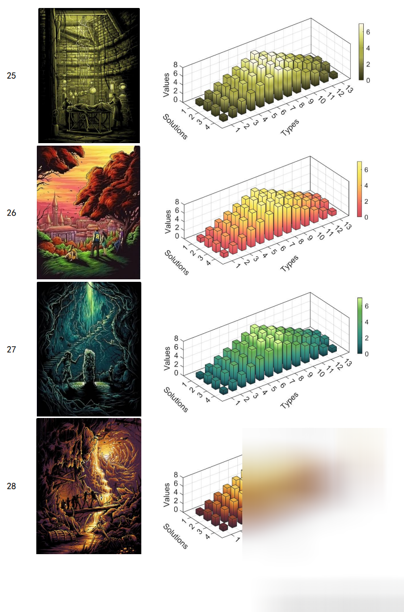

# MATLAB 44 types of anime gradient color plotting subfunctions

\nThis MATLAB function is used for custom drawing gradient colors. We have created 44 gradient colors based on the screenshots of anime, which can be selected for scientific research and graph creation.
Due to the product being made for the author's research needs, it is not intended to be freely available. If you require it, please obtain it on your own. Thank you~
%% Template for drawing a three-dimensional bar chart\nclose all;clear all;clc;\n%% 1 row, 1 column\n% Define the position of the entire image on the computer screen, as well as its length and width.\nfigureHandle = figure;\nfigureUnits = 'centimeters';\nfigureWidth = 10;\nfigureHeight = 6;\nset(gcf, 'Units', figureUnits, 'Position', [0 0 figureWidth figureHeight]);\n%% Data Preparation\n% Define the variable\nX = [1 2 3 4 5 6 7 8 9 10 11 12 13];%13\nY = [1 2 3 4];%4\n% Define the dependent variable\nZ1 = [1 2 3 4 5 6 7 6 5 4 3 2 1];\nZ2 = [2 3 4 5 6 7 7 7 6 5 4 3 2];\nZ3 = [2 3 4 5 6 7 7 7 6 5 4 3 2];\nZ4 = [1 2 3 4 5 6 7 6 5 4 3 2 1];\nZ=[Z1;Z2;Z3;Z4];%4x13\n%% Given the drawing font and size\nfontnamed='Arial';% Font Name\nssize=10;% font size\n%% Given the gradient color for drawing\nCM1 = mymap(34);% If you want to change the gradient color, just change 34 to any number between 1 and 44.\n%% Define drawing parameters\nb = bar3(Z,0.5);\n% hTitle = title(sprintf('(a) RMSE/m (free snow)'));\nhXLabel = xlabel('Types','fontsize',ssize,'FontName',fontnamed,'rotation',45);\nhYLabel = ylabel('Solutions','fontsize',ssize,'FontName',fontnamed,'rotation',-45);\nhZLabel = zlabel('Values','fontsize',ssize,'FontName',fontnamed);\n%% Assign color to the Z-axis\nfor k = 1:length(b)\n    zdata = b(k).ZData;\n    b(k).CData = zdata;\n    b(k).FaceColor = 'interp';\nend\ncolormap(CM1);% Use custom colors\ncb = colorbar;% Add vertical color bars\nset(cb,'unit','centimeters','position',[9.3,2.8,0.2,2.5]);% Set the position and size of the vertical color bar\n%% Standard format code for drawing\n% text(0.5,0.9,'(a) snow','fontsize',ssize,'FontName',fontnamed);%,'horiz','center'\n% xlabel('SNR types','fontsize',ssize,'FontName',fontnamed);\n% ylabel('R (with snow)','fontsize',ssize,'FontName',fontnamed);\naxis([0 14 0 5 0 8]);%Range of XYZ axis\nxticks([1 2 3 4 5 6 7 8 9 10 11 12 13]);% The small graduations when drawing a grid\nxticklabels({'1','2','3','4','5','6','7','8','9','10','11','12','13'});% Add x-axis scale markings, 'C3-MEO-S2I', 'C3-MEO-S6I'\nyticks([1 2 3 4]);% The small graduations when drawing a grid\nyticklabels({'1','2','3','4'});% Add x-axis scale markings\nzticks([0 2 4 6 8]);% The small graduations when drawing a grid\nzticklabels({'0','2','4','6','8'});% Add x-axis scale markings\nset(gca,'xticklabelrotation',-45);\nset(gca,'yticklabelrotation',45);\n% set(gca,'linewidth',1,'fontsize',ssize,'FontName',fontnamed);\n% set(gca,'yticklabel',[]);%yAxes not displayed\n% set(gca,'xticklabel',[]);%xAxes not displayed\ngrid on;box on;hold on;\n%% Background color\nset(gcf,'Color',[1 1 1])\n%% After setting, output according to the required resolution and format.\nfigW = figureWidth;\nfigH = figureHeight;\nset(figureHandle,'PaperUnits',figureUnits);\nset(figureHandle,'PaperPosition',[0 0 figW figH]);\nfileout = 'bar3_1';\nprint(figureHandle,[fileout,'.png'],'-r800','-dpng');\n  

## Images

<!-- PAYMENT_BLOCK -->

## Get this dataset

- Payment link (Stripe): [Buy now](https://buy.stripe.com/3cs8yP7sY87d0vu9AB)
- Payment QR code: 

<!-- /PAYMENT_BLOCK -->
